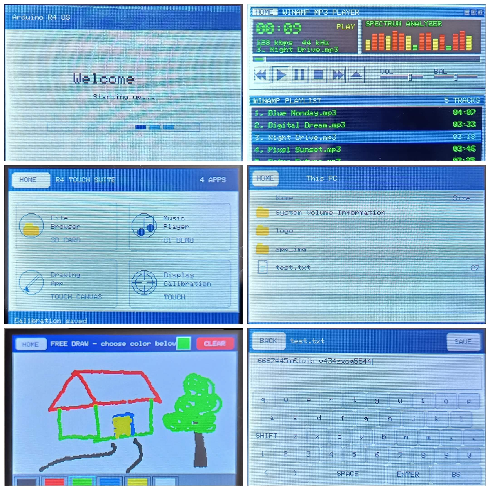
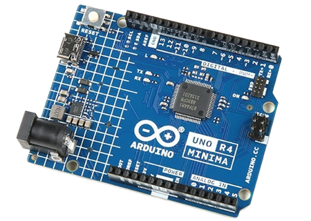
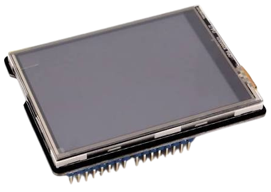

# Arduino R4 OS

**A lightweight touchscreen desktop for the Arduino UNO R4 Minima.**

[](https://docs.arduino.cc/hardware/uno-r4-minima/)
[](https://platformio.org/)
[](https://github.com/adafruit/Adafruit_ILI9341)
[](https://isocpp.org/)
[](https://github.com/Muhammad-Yunus/Arduino-R4-OS/releases)

<p align="center">
  
</p>

Arduino R4 OS is an embedded touchscreen UI for the UNO R4 Minima and a 320×240 ILI9341 display. It brings a compact launcher, SD card tools, drawing, and a Winamp-inspired music-player UI to the board.

## Features

- Light, blue-accented application launcher.
- Display calibration saved persistently in the UNO R4 EEPROM.
- SD card browser with folder navigation and touch scrolling.
- On-device text editor for `.txt` files (up to 1 KiB).
- Touch drawing canvas with a color palette and clear action.
- Winamp-inspired player interface with playlist, transport controls, progress, and spectrum animation. **This is a UI demo; it does not play audio.**
- Partial redraws for frequently updated UI areas to reduce visible flashing.

## Hardware

<p align="center">
  
  
</p>

| Component | Configuration |
| --- | --- |
| MCU | Arduino UNO R4 Minima |
| Display | Seeed 2.8-inch TFT Touch Shield V2.0, ILI9341, 320×240 |
| SD card | FAT32 |
| TFT chip select | D10 |
| TFT data/command | D6 |
| TFT backlight | D7 |
| SD chip select | D4 |
| SPI | SCK D13, MISO D12, MOSI D11 |
| Resistive touch | A0–A3 |

Use the display and touch shield with the pin assignments above. The TFT and SD card share SPI.

## Stack

- **PlatformIO** with the `uno_r4_minima` environment.
- **Arduino framework for Renesas RA** on the UNO R4 Minima.
- **Adafruit GFX** and **Adafruit ILI9341** for display rendering.
- **Adafruit TouchScreen** for resistive touch input.
- **SdFat** for SD card access.
- **EEPROM** for persistent calibration data.

## Build and upload

Install [PlatformIO Core](https://docs.platformio.org/en/latest/core/installation/index.html) or the PlatformIO IDE extension for VS Code, then connect the UNO R4 Minima over USB.

Build the firmware:

```powershell
pio run -e uno_r4_minima
```

Build and upload it to a connected board:

```powershell
pio run -e uno_r4_minima -t upload
```

The build output is written to:

```text
.pio/build/uno_r4_minima/firmware.bin
```

The current firmware binary is board-specific and is ignored by Git as part of the `.pio` build directory.

## Project structure

```text
.
├── include/                 # PlatformIO project headers
├── lib/                     # Project-local libraries
├── scripts/                 # Optional helper scripts
├── src/
│   ├── AppLauncher.cpp      # Splash, launcher, calibration, app routing
│   ├── AppLauncher.h
│   ├── DrawingApp.cpp       # Touch drawing canvas
│   ├── DrawingApp.h
│   ├── FileBrowserApp.cpp   # SD browser and TXT editor
│   ├── FileBrowserApp.h
│   ├── MusicPlayerApp.cpp   # Winamp-inspired UI demo
│   ├── MusicPlayerApp.h
│   ├── TouchInput.cpp       # Touch sampling and coordinate mapping
│   ├── TouchInput.h
│   └── main.cpp             # Hardware setup and application loop
├── test/                    # PlatformIO test directory
├── .gitignore
└── platformio.ini           # Board, framework, dependencies, and build flags
```

## Repository

**Origin:** [Muhammad-Yunus/Arduino-R4-OS](https://github.com/Muhammad-Yunus/Arduino-R4-OS)
